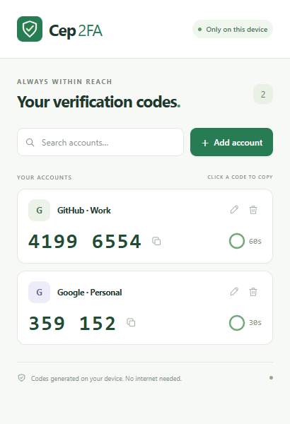

# Cep 2FA

**Your verification codes, one click away.**

A lightweight Chrome and Microsoft Edge extension for saving multiple 2FA accounts and generating their current codes directly in your browser. Works offline, with an English interface and no external services.



## Features

- **Multiple accounts:** save your 2FA secrets under names you recognize.
- **Live codes:** codes refresh automatically, with a countdown for each account.
- **One-click copy:** click a code to copy it without spaces.
- **Quick search:** find an account by name.
- **Account management:** edit accounts or delete them with confirmation.
- **Flexible input:** paste a Base32 secret or an `otpauth://totp/...` link. Lowercase letters and spaces are accepted.
- **Local storage:** secrets stay in your browser profile; no account, server, or browser sync is required.

## Install

No build step, npm installation, or server is needed to use the extension.

1. Download this repository using **Code → Download ZIP** and extract it, or clone the branch you want to install.
2. Open `chrome://extensions` in Chrome or `edge://extensions` in Edge.
3. Enable **Developer mode**.
4. Click **Load unpacked** and select the extracted folder containing `manifest.json`.
5. Pin **Cep 2FA** to your toolbar from the browser's extensions menu.

If you have a packaged `cep-2fa.zip`, extract it and load the folder the same way. Keep the installed folder in place so the browser can continue loading its files.

## Use

1. Click the extension icon, then **Add account**.
2. Enter an account name and paste its 2FA secret. The same Base32 secrets used with 2fa.live work here. You can also paste an `otpauth` link; the account name can be read from the link if you leave it blank.
3. Click **Save account**. Repeat for additional accounts.
4. Open the extension whenever you need a current code. Click the code to copy it.

Use the pencil icon to edit an account and the trash icon to delete it. Deleting a saved account only removes it from this extension; it does not disable 2FA on the original service.

## Supported formats

| Setting        | Plain Base32 secret | `otpauth://totp` link   |
| -------------- | ------------------- | ----------------------- |
| Algorithm      | SHA-1               | SHA-1, SHA-256, SHA-512 |
| Code length    | 6 digits            | 6 or 8 digits           |
| Refresh period | 30 seconds          | 1–300 seconds           |

Editing an existing account with a plain secret preserves its algorithm, code length, and refresh period. Counter-based HOTP is not supported.

## Privacy and storage

Secrets are saved in `chrome.storage.local` for the current browser profile. Codes are generated on your device using the Web Crypto API. The extension makes no network requests, has no website access, and does not use browser sync.

Only two permissions are requested:

| Permission       | Purpose                                       |
| ---------------- | --------------------------------------------- |
| `storage`        | Save accounts locally between popup sessions. |
| `clipboardWrite` | Copy a verification code when you click it.   |

This version has no password lock or application-level encryption. Someone with access to your browser profile may be able to read your secrets. Keep the original secrets and service recovery codes somewhere safe: uninstalling the extension or deleting the profile removes the locally saved accounts. Copied codes remain in your system clipboard until replaced or cleared.

## Troubleshooting

- **A service rejects the code:** check that your computer's date, time, and time zone are set automatically. Also check that you saved the complete secret for the correct account.
- **The secret is rejected:** paste the original Base32 secret, not a six-digit verification code. Supported secrets contain letters A–Z and digits 2–7, with at least 16 characters before padding.
- **The popup reports a storage error:** open it through the installed extension icon, rather than opening `popup.html` as a regular file.
- **Changes are not visible after editing the source:** reload the extension on the browser's extensions page, then reopen the popup.

## Development

The runtime uses plain HTML, CSS, and JavaScript with Manifest V3. Node.js 20+ is required for tests and packaging.

Run the dependency-free TOTP and manifest tests:

```sh
npm test
```

Run the UI checks against the actual unpacked extension in Chromium:

```sh
npm ci
npx playwright install chromium
npm run test:ui
```

The tests cover RFC 6238 vectors for all three supported algorithms, time boundaries, input validation, account persistence, search, editing, deletion, copying, and automatic refresh. Browser tests use a separate temporary profile and public test secrets; they do not access your regular browser profile.

Create a distributable ZIP:

```sh
npm run package
```

The archive is written to `dist/cep-2fa.zip` and contains the runtime files, this README, and its screenshot. It excludes saved accounts, dependencies, tests, and browser profiles. The screenshot uses public test data.

To regenerate the included PNG icons, install Pillow and run `python scripts/icons.py`.
